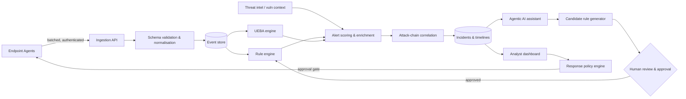

<div align="center">

# 🛡️ SentinelForge

### An Agentic AI-Driven Endpoint Detection and Response (EDR) Framework

*Cross-platform telemetry · Hybrid detection · Attack-chain correlation · Evidence-grounded AI assistance · Human-approved adaptive rules*


*Final Year Project · B.Tech (CSE-CSF) · GLA University, Mathura · Session 2026-27 · Group G-2*

</div>

---

> ⚠️ **Authorised use only.** SentinelForge is a defensive research prototype. Deploy agents only on systems you own or have explicit written permission to monitor, and run all attack simulations inside an isolated, authorised laboratory.

## 📑 Table of Contents

1. [Overview](#-overview)
2. [Motivation](#-motivation)
3. [Key Features](#-key-features)
4. [System Architecture](#-system-architecture)
5. [Component Deep Dive](#-component-deep-dive)
6. [Unified Event Schema](#-unified-event-schema)
7. [Detection Pipeline](#-detection-pipeline)
8. [Agentic AI Assistant](#-agentic-ai-assistant)
9. [Human-Guided Adaptive Rule Lifecycle](#-human-guided-adaptive-rule-lifecycle)
10. [Policy-Controlled Response](#-policy-controlled-response)
11. [Data Model](#-data-model)
12. [API Overview](#-api-overview)
13. [Tech Stack](#-tech-stack)
14. [Repository Structure](#-repository-structure)
15. [Getting Started](#-getting-started)
16. [Configuration](#-configuration)
17. [Evaluation Methodology](#-evaluation-methodology)
18. [Security & Threat Model](#-security--threat-model-of-the-framework-itself)
19. [Roadmap](#-roadmap)
20. [Testing](#-testing)
21. [Team](#-team)
22. [License & Disclaimer](#-license--disclaimer)

---

## 🔎 Overview

**SentinelForge** is an AI-assisted Endpoint Detection and Response (EDR) framework that monitors **Windows and Linux** endpoints through one unified platform.

Lightweight agents collect process, authentication, file, service, persistence, and network events. A central service validates and normalises this telemetry into a common schema. The platform then combines **deterministic rule-based detection** with **User and Entity Behaviour Analytics (UEBA)**, enriches alerts with **threat-intelligence** and authorised vulnerability context, and uses **attack-chain correlation** to link related events into evidence-backed incident timelines.

An **agentic AI assistant** helps analysts retrieve evidence, interpret alerts, and draft investigation summaries. A **human-guided adaptive detection workflow** lets validated anomalies become candidate rules that must pass schema validation, replay testing, review, and approval before they are ever deployed.

The design deliberately emphasises **explainability, auditability, and controlled response** over unrestricted autonomous action.

## 💡 Motivation

| Problem | SentinelForge's answer |
|---|---|
| Static rules miss novel behaviour | UEBA anomaly scoring alongside rules |
| Anomaly detectors raise alerts with no context | Threat-intel enrichment + attack-chain timelines |
| Analysts spend long hours stitching evidence together | Agentic assistant that retrieves and summarises evidence |
| Auto-generated detections are risky to ship | Validate → replay-test → review → approve → version → roll back |
| Autonomous response can cause damage | Role-based permissions, approval gates, audit records |

## ✨ Key Features

- **Cross-platform telemetry** — Windows (Event Log / ETW) and Linux (journald / auditd) under a shared event schema.
- **Hybrid detection** — deterministic rules + UEBA anomaly scoring + threat-intelligence context.
- **Attack-chain correlation** — evidence-linked incident timelines built from related events.
- **Agentic AI assistant** — natural-language investigation with evidence-grounded summaries.
- **Adaptive rule lifecycle** — generate, validate, replay-test, approve, version, and roll back candidate rules.
- **Policy-controlled response** — role permissions, approval gates, and tamper-evident audit records.
- **Analyst dashboard** — alerts, incidents, timelines, entity views, and rule management in one UI.
- **Measurable by design** — built-in evaluation harness for precision, recall, FPR, latency, and overhead.

## 🏗️ System Architecture

### High-level view

```
┌──────────────────────────────────────────────────────────────────────────────┐
│                               ENDPOINT LAYER                                 │
│                                                                              │
│   ┌─────────────────────────┐              ┌─────────────────────────┐       │
│   │     Windows Agent       │              │       Linux Agent       │       │
│   │  • Event Log / ETW      │              │  • journald / auditd    │       │
│   │  • Process, Auth, File  │              │  • Process, Auth, File  │       │
│   │  • Service, Persistence │              │  • Service, Persistence │       │
│   │  • Network              │              │  • Network              │       │
│   └────────────┬────────────┘              └────────────┬────────────┘       │
└────────────────┼────────────────────────────────────────┼────────────────────┘
                 │        TLS · Agent auth · Batching     │
                 ▼                                        ▼
┌──────────────────────────────────────────────────────────────────────────────┐
│                           INGESTION & NORMALISATION                          │
│        FastAPI Ingestion API → Pydantic validation → Common Event Schema     │
└────────────────────────────────────┬─────────────────────────────────────────┘
                                     ▼
┌──────────────────────────────────────────────────────────────────────────────┐
│                                STORAGE LAYER                                 │
│     Events · Alerts · Incidents · Entities · Baselines · Rules · Audit log   │
│                         (PostgreSQL / SQLite)                                │
└───────┬───────────────────────┬───────────────────────┬──────────────────────┘
        ▼                       ▼                       ▼
┌───────────────┐      ┌─────────────────┐      ┌───────────────────┐
│  RULE ENGINE  │      │  UEBA ENGINE    │      │  THREAT INTEL &   │
│  (deterministic)     │  (scikit-learn) │      │  VULN CONTEXT     │
└───────┬───────┘      └────────┬────────┘      └─────────┬─────────┘
        └───────────────┬───────┴─────────────────────────┘
                        ▼
              ┌───────────────────┐
              │  ALERT SCORING &  │
              │   ENRICHMENT      │
              └─────────┬─────────┘
                        ▼
              ┌───────────────────┐
              │ ATTACK-CHAIN      │
              │ CORRELATION       │──► Incident timelines
              └─────────┬─────────┘
                        │
        ┌───────────────┼──────────────────────────┐
        ▼               ▼                          ▼
┌───────────────┐ ┌──────────────────┐   ┌────────────────────┐
│ ANALYST       │ │ AGENTIC AI       │   │ ADAPTIVE RULE      │
│ DASHBOARD     │◄┤ ASSISTANT        │──►│ WORKFLOW           │
│ (React)       │ │ (read-only tools)│   │ (human-approved)   │
└───────┬───────┘ └──────────────────┘   └────────────────────┘
        ▼
┌──────────────────────────────────────────────────────────────────────────────┐
│          POLICY-CONTROLLED RESPONSE  (RBAC · approval gates · audit)         │
└──────────────────────────────────────────────────────────────────────────────┘
```

### Data flow



## 🧩 Component Deep Dive

### 1. Endpoint agents
Lightweight collectors that gather only *selected* telemetry to limit overhead and privacy exposure.

| Category | Windows source | Linux source |
|---|---|---|
| **Process** | ETW / Security 4688, Sysmon (optional) | auditd `execve`, `/proc` |
| **Authentication** | Security 4624/4625/4648/4672 | journald (sshd, sudo, PAM), `auth` logs |
| **File** | ETW file events, selected-path monitoring | auditd watches, inotify |
| **Service** | System 7045, service control events | systemd unit events |
| **Persistence** | Run keys, scheduled tasks, services | cron, systemd units, shell profiles, authorized_keys |
| **Network** | ETW network events | auditd/`ss` snapshots, connection logs |

Agent responsibilities: collect → filter → batch → sign/authenticate → ship, with local buffering when the server is unreachable and a configurable resource ceiling.

### 2. Ingestion service
A FastAPI service that authenticates agents, validates payloads with Pydantic, normalises into the common schema, rejects malformed or oversized events, and writes to storage.

### 3. Storage layer
Relational store (PostgreSQL for the full stack, SQLite for quick local runs) holding events, alerts, incidents, entity profiles, baselines, rules and versions, and the audit log.

### 4. Rule engine
Deterministic, declarative rules evaluated against normalised events (single-event and sequence/threshold rules). Rules are versioned, schema-validated, and carry metadata (severity, description, ATT&CK mapping, author, approval record).

### 5. UEBA engine
Learns per-user and per-host baselines (e.g., login hours, process lineage, rare binaries, unusual parent-child pairs, network destinations) and produces an **explainable anomaly score** using scikit-learn models. Every score ships with the top contributing features so an analyst can see *why* it fired.

### 6. Threat-intelligence & vulnerability context
Enriches alerts with indicator matches (hashes, IPs, domains) and authorised vulnerability context for the affected host, so severity reflects real exposure.

### 7. Attack-chain correlation
Links related alerts and events — by entity, process tree, time window, and technique progression — into a single **evidence-linked incident timeline** (e.g., initial access → execution → persistence → credential access → lateral movement).

### 8. Analyst dashboard
React-based UI for alert triage, incident timelines, entity/host views, rule management, approval queues, and the assistant chat panel.

### 9. Agentic AI assistant
See [Agentic AI Assistant](#-agentic-ai-assistant).

### 10. Adaptive rule workflow
See [Human-Guided Adaptive Rule Lifecycle](#-human-guided-adaptive-rule-lifecycle).

### 11. Response policy engine
See [Policy-Controlled Response](#-policy-controlled-response).

## 📐 Unified Event Schema

All telemetry is normalised into one cross-platform schema (illustrative example):

```json
{
  "event_id": "b6f1c9e2-3a4d-4c1e-9f0a-7e5d2c1b8a90",
  "timestamp": "2026-01-15T10:42:07.318Z",
  "host": {
    "host_id": "win-lab-01",
    "os": "windows",
    "os_version": "10.0.19045",
    "agent_version": "0.1.0"
  },
  "category": "process",
  "action": "create",
  "user": { "name": "labuser", "sid": "S-1-5-21-...", "privilege": "standard" },
  "process": {
    "pid": 4312,
    "name": "powershell.exe",
    "path": "C:\\Windows\\System32\\WindowsPowerShell\\v1.0\\powershell.exe",
    "command_line": "powershell.exe -enc ...",
    "hash": { "sha256": "..." },
    "parent": { "pid": 2210, "name": "winword.exe" }
  },
  "network": null,
  "file": null,
  "raw": { "source": "ETW", "provider": "Microsoft-Windows-Kernel-Process" },
  "schema_version": "1.0"
}
```

Supported categories: `process`, `authentication`, `file`, `service`, `persistence`, `network`.

## 🎯 Detection Pipeline

1. **Ingest & normalise** — validate against the shared schema.
2. **Rule matching** — deterministic detections against known suspicious patterns.
3. **UEBA scoring** — compare behaviour with entity baselines; produce score plus feature attributions.
4. **Enrichment** — attach threat-intel matches and vulnerability context.
5. **Alert scoring** — combine rule severity, anomaly score, and context into a prioritised alert.
6. **Correlation** — group alerts into incidents and build the attack-chain timeline.
7. **Analyst workflow** — triage in dashboard, investigate with the assistant, decide on response.

## 🤖 Agentic AI Assistant

The assistant is an **analyst co-pilot, not an autonomous operator.**

**What it can do**
- Answer natural-language questions ("What did `host-07` do in the 10 minutes before this alert?").
- Retrieve events, alerts, entity history, and incident timelines via tools.
- Explain why an alert fired (rule logic, anomaly features, intel matches).
- Produce investigation summaries that **cite the underlying event IDs**.
- Propose candidate detection rules for analyst review.

**Design guardrails**
- **Read-only tool set** by default — retrieval and analysis tools only.
- **Evidence-grounded outputs** — claims must reference stored events; unsupported statements are flagged.
- **No direct response actions** — any consequential action is routed through the policy engine and human approval.
- **Prompt-injection awareness** — telemetry content (command lines, file names, log text) is treated as *untrusted data*, never as instructions.
- **Full logging** — prompts, tool calls, and outputs are recorded in the audit log.

```
Analyst question ─► Planner ─► Tool calls (search_events, get_incident, get_entity,
                                           get_alert_explanation, intel_lookup)
                       ▲                         │
                       └──── evidence ◄──────────┘
                                   ▼
                  Grounded answer with event-ID citations
```

## 🔄 Human-Guided Adaptive Rule Lifecycle

Validated novel behaviour can be turned into detection rules — **but never deployed automatically**.

```
 ┌──────────┐   ┌───────────┐   ┌─────────────┐   ┌──────────┐   ┌──────────┐   ┌──────────┐
 │ Generate │──►│  Schema   │──►│ Replay-test │──►│  Human   │──►│ Version  │──►│  Deploy  │
 │ candidate│   │ validation│   │ (+ve & benign)  │  review  │   │ & sign   │   │ (staged) │
 └──────────┘   └───────────┘   └─────────────┘   └────┬─────┘   └──────────┘   └────┬─────┘
                                                       │ reject                      │
                                                       ▼                             ▼
                                                  Archived                    Monitor → Rollback
```

| Stage | Purpose |
|---|---|
| **Generate** | Draft a candidate from a validated anomaly or analyst request |
| **Schema validation** | Reject malformed rules, unknown fields, unsafe patterns |
| **Replay testing** | Run against labelled malicious data (must detect) and benign data (must not over-alert) |
| **Review** | Analyst inspects logic, test results, and expected noise |
| **Approval** | Authorised approver signs off; recorded in the audit log |
| **Versioning** | Immutable versions with diffs and authorship |
| **Rollback** | One-step revert to any prior approved version |

## 🚦 Policy-Controlled Response

Response actions are **gated, role-aware, and audited**.

| Role | Typical permissions |
|---|---|
| **Viewer** | Read alerts, incidents, dashboards |
| **Analyst** | Investigate, annotate, use assistant, propose rules, request response |
| **Approver / Lead** | Approve rules and response actions |
| **Admin** | Manage users, policies, agent enrolment |

Example response actions (lab scope): tag host, isolate host (simulated/network policy), collect additional artefacts, kill a process, disable an account — each requiring the policy-defined approval level, with justification and an immutable audit entry.

## 🗄️ Data Model

Core entities (simplified):

```
Host ──< Event >── User
  │         │
  │         └──< Alert >──┐
  │                       ├──> Incident ──< TimelineEntry
  └──< Baseline           │
                          └──> Rule ──< RuleVersion ──< ApprovalRecord

AuditLog (append-only):  actor · action · target · justification · timestamp · hash-chain
```

## 🔌 API Overview

> Endpoint names are indicative and will be finalised during implementation.

| Area | Example endpoints |
|---|---|
| **Agents** | `POST /v1/agents/enroll`, `POST /v1/ingest/events`, `GET /v1/agents/{id}/config` |
| **Events** | `GET /v1/events`, `GET /v1/events/{id}` |
| **Alerts** | `GET /v1/alerts`, `PATCH /v1/alerts/{id}` |
| **Incidents** | `GET /v1/incidents`, `GET /v1/incidents/{id}/timeline` |
| **Entities** | `GET /v1/hosts/{id}`, `GET /v1/users/{id}/baseline` |
| **Rules** | `GET/POST /v1/rules`, `POST /v1/rules/{id}/test`, `POST /v1/rules/{id}/approve`, `POST /v1/rules/{id}/rollback` |
| **Assistant** | `POST /v1/assistant/query` |
| **Response** | `POST /v1/response/requests`, `POST /v1/response/{id}/approve` |
| **Audit** | `GET /v1/audit` |

Interactive docs are served by FastAPI at `/docs` (Swagger UI) and `/redoc`.

## 🧰 Tech Stack

| Layer | Technology |
|---|---|
| Language | Python 3.11+ |
| Backend API | FastAPI, Pydantic |
| ML / UEBA | scikit-learn |
| Storage | PostgreSQL (full stack) / SQLite (local dev) |
| Dashboard | React (or lightweight web dashboard) |
| AI orchestration | LangChain (optional) |
| Telemetry sources | Windows Event Log / ETW · Linux journald / auditd |
| Packaging | Docker Compose |
| Testing & VCS | pytest · Git |

## 📁 Repository Structure

> Proposed layout — adjust as the codebase evolves.

```
sentinelforge/
├── agents/
│   ├── windows/            # Event Log / ETW collector
│   ├── linux/              # journald / auditd collector
│   └── common/             # batching, buffering, transport, config
├── server/
│   ├── api/                # FastAPI routers (ingest, alerts, incidents, rules, ...)
│   ├── core/               # config, auth, RBAC, logging
│   ├── schema/             # Pydantic models, event schema versions
│   ├── ingestion/          # validation & normalisation
│   ├── detection/
│   │   ├── rules/          # rule engine & loader
│   │   └── ueba/           # baselines, features, models, explainability
│   ├── intel/              # threat-intel & vulnerability context
│   ├── correlation/        # attack-chain builder & timelines
│   ├── assistant/          # agent, tools, guardrails, prompts
│   ├── rulelifecycle/      # generate, validate, replay, approve, version, rollback
│   ├── response/           # policy engine, approval gates
│   ├── audit/              # append-only, hash-chained audit log
│   └── db/                 # models, migrations
├── dashboard/              # React UI
├── rules/                  # shipped detection rules (YAML/JSON)
├── datasets/               # labelled lab scenarios & benign baselines
├── evaluation/             # metrics harness, scenario runners, reports
├── deploy/                 # docker-compose, env templates
├── docs/                   # design docs, diagrams, report
├── tests/                  # pytest suites (unit, integration, replay)
├── docker-compose.yml
├── LICENSE
└── README.md
```

## 🚀 Getting Started

### Prerequisites
- Docker & Docker Compose
- Python 3.11+
- A Windows and a Linux VM (or hosts) inside an **isolated lab network**
- 8 GB RAM minimum on the host running the stack

### 1. Clone
```bash
git clone https://github.com/<your-username>/SentinelForge.git
cd SentinelForge
```

### 2. Configure environment
```bash
cp deploy/.env.example deploy/.env
# Edit secrets, database URL, and assistant/LLM settings
```

### 3. Start the platform
```bash
docker compose up -d --build
```

| Service | URL |
|---|---|
| Dashboard | `http://localhost:3000` |
| API | `http://localhost:8000` |
| API docs | `http://localhost:8000/docs` |

### 4. Enrol an agent

**Linux**
```bash
cd agents/linux
pip install -r requirements.txt
python -m sentinelforge_agent --server https://<server>:8000 --enroll-token <TOKEN>
```

**Windows (PowerShell, elevated)**
```powershell
cd agents\windows
pip install -r requirements.txt
python -m sentinelforge_agent --server https://<server>:8000 --enroll-token <TOKEN>
```

### 5. Local development without Docker
```bash
python -m venv .venv && source .venv/bin/activate
pip install -r server/requirements.txt
export SF_DATABASE_URL=sqlite:///./sentinelforge.db
uvicorn server.api.main:app --reload
```

## ⚙️ Configuration

| Variable | Description | Example |
|---|---|---|
| `SF_DATABASE_URL` | Database connection string | `postgresql://sf:***@db:5432/sentinelforge` |
| `SF_SECRET_KEY` | Signing key for tokens | *(generate a strong random value)* |
| `SF_AGENT_ENROLL_TOKEN` | Token for agent enrolment | *(rotate regularly)* |
| `SF_ASSISTANT_ENABLED` | Toggle the AI assistant | `true` |
| `SF_LLM_PROVIDER` / `SF_LLM_MODEL` | Model backend for the assistant | *(provider-specific)* |
| `SF_INTEL_FEEDS` | Threat-intel sources | `local,csv:/data/iocs.csv` |
| `SF_RESPONSE_MODE` | `observe` · `approval` | `approval` |
| `SF_LOG_LEVEL` | Logging verbosity | `INFO` |

**Never commit real secrets.** Use `.env` files excluded via `.gitignore`.

## 📊 Evaluation Methodology

SentinelForge is evaluated in an **authorised, isolated laboratory** with controlled scenarios.

**Scenario families (benign simulation / emulation only)**
- Suspicious process chains (e.g., office app spawning a script interpreter)
- Authentication anomalies (brute-force patterns, unusual logon times)
- Persistence creation (scheduled tasks/cron, services, startup entries)
- Suspicious file and network behaviour
- Multi-stage chains for correlation testing
- Long benign runs to measure false positives

**Metrics**

| Metric | Definition |
|---|---|
| **Precision** | TP / (TP + FP) |
| **Recall** | TP / (TP + FN) |
| **False-positive rate** | FP / (FP + TN) |
| **Detection latency** | Time from event occurrence to alert |
| **Resource overhead** | Agent CPU / RAM / disk / network usage |
| **Investigation efficiency** | Time-to-summary with vs. without the assistant |
| **Rule-workflow quality** | Candidate pass rate, review rejections, rollback frequency |

Ablations compare **rules only**, **UEBA only**, and **hybrid** detection, plus correlation on/off.

Results, scripts, and reports live under [`evaluation/`](evaluation/).

## 🔐 Security & Threat Model of the Framework Itself

An EDR is a high-value target. SentinelForge treats its own security as a first-class requirement.

| Risk | Mitigation |
|---|---|
| Rogue or spoofed agent | Enrolment tokens, per-agent credentials, mutual TLS (planned) |
| Telemetry tampering | Signed batches, server-side validation and anomaly checks |
| Malicious data targeting the AI | Telemetry treated as untrusted; no instruction-following from event content |
| Over-privileged assistant | Read-only tools, scoped permissions, full logging |
| Unsafe auto-generated rules | Schema validation, replay testing, mandatory human approval |
| Abuse of response actions | RBAC, approval gates, justification, append-only audit |
| Sensitive data exposure | Selective collection, minimisation, access control, retention limits |
| Audit log tampering | Append-only, hash-chained entries |

## 🗺️ Roadmap

- [x] Project definition, synopsis & approval
- [ ] **Phase 1** — Literature review, requirements, technology study
- [ ] **Phase 2** — Event schema; Windows & Linux agent prototypes
- [ ] **Phase 3** — Ingestion API, storage, dashboard skeleton
- [ ] **Phase 4** — Rule engine, UEBA baselines & anomaly scoring
- [ ] **Phase 5** — Threat-intel enrichment, attack-chain correlation
- [ ] **Phase 6** — Agentic assistant, adaptive rule workflow
- [ ] **Phase 7** — Lab testing, evaluation, report, final demo

**Future ideas:** macOS agent, Sigma rule import/export, MITRE ATT&CK coverage heatmap, federated/multi-tenant mode, richer response playbooks.

## 🧪 Testing

```bash
pip install -r requirements-dev.txt
pytest -q                      # unit + integration
pytest tests/replay -q         # detection replay tests against labelled datasets
python -m evaluation.run --scenario all --report out/report.html
```

## 👥 Team

**Group G-2 — B.Tech (CSE-CSF), GLA University, Mathura (Session 2026-27)**

| Name | University Roll No. |
|---|---|
| Garima Mittal | 2315300006 |
| Nitin Sikarwar | 2315300014 |
| Pragati Varshney | 2315300016 |
| Saksham Wadhwa | 2315300025 |
| Vibhu Yadav | 2315300033 |

**Project Supervisor:** Mr. Rahul Shandilya, Assistant Professor
**Department:** Computer Engineering & Applications, GLA University, Mathura

## 📜 License & Disclaimer

Released under the **MIT License** — see [`LICENSE`](LICENSE).

SentinelForge is an academic research prototype provided *as is*, without warranty. It is not a certified or production-ready security product. The authors are not responsible for misuse. Use only on systems you are authorised to monitor and test.

---

<div align="center">

**Built with 🛡️ for defenders · GLA University, Mathura**

</div>
