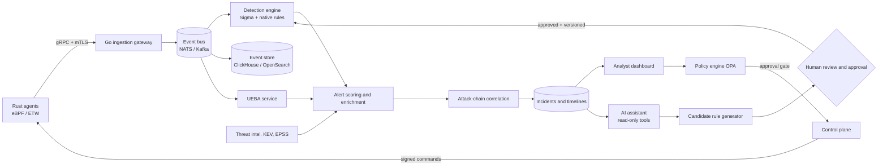

<div align="center">

# 🛡️ SentinelForge

### Agentic AI-driven Endpoint Detection & Response (EDR) for Windows and Linux

*Kernel-level telemetry · Hybrid detection (Sigma + UEBA) · Attack-chain correlation · Evidence-grounded AI analyst · Human-approved adaptive rules*


</div>

---

> 🚧 **Project status: early development.** SentinelForge is in its design and architecture stage. This document describes the target design and roadmap. Sections marked *(planned)* are not implemented yet. Nothing here should be read as shipped functionality.

> ⚠️ **Authorised use only.** Deploy agents only on systems you own or have explicit written permission to monitor, and run all attack simulations in an isolated lab.

## 📑 Table of Contents

1. [Overview](#-overview)
2. [Why SentinelForge](#-why-sentinelforge)
3. [Key Features](#-key-features)
4. [Architecture](#-architecture)
5. [Component Deep Dive](#-component-deep-dive)
6. [Event Schema](#-event-schema)
7. [Detection Pipeline](#-detection-pipeline)
8. [Agentic AI Assistant](#-agentic-ai-assistant)
9. [Adaptive Rule Lifecycle](#-adaptive-rule-lifecycle)
10. [Policy-Controlled Response](#-policy-controlled-response)
11. [Tech Stack](#-tech-stack)
12. [Reused Open-Source Components](#-reused-open-source-components)
13. [Repository Structure](#-repository-structure)
14. [Getting Started](#-getting-started)
15. [Configuration](#-configuration)
16. [Evaluation & Benchmarking](#-evaluation--benchmarking)
17. [Security Model](#-security-model-of-the-edr-itself)
18. [Roadmap](#-roadmap)
19. [Contributing](#-contributing)
20. [License & Disclaimer](#-license--disclaimer)

---

## 🔎 Overview

**SentinelForge** is an open-source EDR platform that monitors **Windows and Linux** endpoints through one unified pipeline.

A lightweight native agent collects process, authentication, file, service, persistence and network telemetry. A gateway validates and normalises events into a common schema and streams them to a detection engine that combines **Sigma and native rules** with **User and Entity Behaviour Analytics (UEBA)**. Alerts are enriched with threat-intelligence and vulnerability context, then **correlated into attack-chain incident timelines**.

An **agentic AI assistant** helps analysts retrieve evidence, explain alerts and draft investigation summaries, using read-only tools and citing the underlying events. A **human-approved adaptive rule workflow** turns validated novel behaviour into candidate detections that must pass validation, replay testing and review before they are ever deployed.

The design deliberately favours **explainability, auditability and controlled response** over unrestricted autonomous action.

## 💡 Why SentinelForge

| Problem | Approach |
|---|---|
| Static rules miss novel behaviour | UEBA anomaly scoring alongside Sigma and native rules |
| Anomaly alerts arrive without context | Threat-intel enrichment and attack-chain timelines |
| Analysts spend hours stitching evidence together | AI assistant that retrieves evidence and cites event IDs |
| Auto-generated detections are risky | Validate → replay-test → review → approve → version → roll back |
| Autonomous response can cause damage | RBAC, policy-as-code approval gates, tamper-evident audit log |
| Agent updates can brick endpoints | Signed, staged rollouts with automatic rollback *(planned)* |

## ✨ Key Features

- **Native cross-platform agent** — Rust agent using eBPF on Linux and ETW (plus an optional kernel driver) on Windows.
- **Hybrid detection** — Sigma rules, native rules, UEBA anomaly scores and threat-intel context.
- **Attack-chain correlation** — evidence-linked incident timelines mapped to MITRE ATT&CK.
- **Agentic AI analyst** — natural-language investigation with citations and read-only tools.
- **Adaptive rule lifecycle** — generate, validate, replay-test, approve, version and roll back detections.
- **Policy-controlled response** — role permissions and approval gates enforced as code (OPA).
- **Secure by design** — mTLS, signed updates, hash-chained audit log, agent self-protection *(planned)*.
- **Measurable** — built-in benchmarking for precision, recall, FPR, latency and agent overhead.

## 🏗️ Architecture

### System overview

```
┌──────────────────────────────────────────────────────────────────────────────────┐
│                                  ENDPOINTS                                       │
│                                                                                  │
│   ┌──────────────────────────────┐        ┌──────────────────────────────┐       │
│   │        Windows Agent         │        │         Linux Agent          │       │
│   │  Rust core                   │        │  Rust core                   │       │
│   │  • ETW providers             │        │  • eBPF sensors (aya)        │       │
│   │  • Kernel driver (optional)  │        │  • auditd / fanotify fallback│       │
│   │  • Self-protection           │        │  • Self-protection           │       │
│   │  • Local queue + governor    │        │  • Local queue + governor    │       │
│   └──────────────┬───────────────┘        └──────────────┬───────────────┘       │
└──────────────────┼───────────────────────────────────────┼───────────────────────┘
                   │         gRPC + Protobuf over mTLS     │
                   ▼                                       ▼
┌──────────────────────────────────────────────────────────────────────────────────┐
│                          INGESTION GATEWAY  (Go)                                 │
│    Agent auth · schema validation · normalisation · rate limiting · enrolment    │
└───────────────────────────────────────┬──────────────────────────────────────────┘
                                        ▼
                       ┌───────────────────────────────┐
                       │   EVENT BUS (NATS / Kafka)    │
                       └───┬───────────┬───────────┬───┘
                           ▼           ▼           ▼
              ┌─────────────────┐ ┌──────────┐ ┌────────────────┐
              │ DETECTION ENGINE│ │ EVENT    │ │ UEBA SERVICE   │
              │ (Rust)          │ │ STORE    │ │ (Python)       │
              │ Sigma + native  │ │ ClickHouse│ │ baselines,     │
              │ rules, sequences│ │ / Open-  │ │ anomaly scores,│
              │                 │ │ Search   │ │ explanations   │
              └────────┬────────┘ └────┬─────┘ └───────┬────────┘
                       └───────────────┼───────────────┘
                                       ▼
                     ┌───────────────────────────────────┐
                     │  ENRICHMENT & ALERT SCORING       │
                     │  threat intel · KEV/EPSS · ATT&CK │
                     └─────────────────┬─────────────────┘
                                       ▼
                     ┌───────────────────────────────────┐
                     │  ATTACK-CHAIN CORRELATION         │──► Incident timelines
                     └─────────────────┬─────────────────┘
                                       │
          ┌────────────────────────────┼─────────────────────────────┐
          ▼                            ▼                             ▼
┌───────────────────┐      ┌─────────────────────┐       ┌────────────────────────┐
│ ANALYST DASHBOARD │◄────►│ AI ASSISTANT        │──────►│ ADAPTIVE RULE WORKFLOW │
│ (React/TypeScript)│      │ (Python, read-only  │       │ validate → replay →    │
│                   │      │  tools, guardrails) │       │ approve → version      │
└─────────┬─────────┘      └─────────────────────┘       └────────────────────────┘
          ▼
┌──────────────────────────────────────────────────────────────────────────────────┐
│     CONTROL PLANE (Go) + POLICY ENGINE (OPA)                                     │
│     RBAC · approval gates · response orchestration · signed agent updates        │
│     PostgreSQL: rules, users, incidents, policies, hash-chained audit log        │
└──────────────────────────────────────────────────────────────────────────────────┘
```

### Data flow



## 🧩 Component Deep Dive

### 1. Endpoint agent (Rust)
A small, privileged, self-protecting sensor.

| Category | Windows | Linux |
|---|---|---|
| **Process** | ETW kernel/process providers, process-creation callbacks (driver) | eBPF (`execve`, `exit`, fork lineage) |
| **Authentication** | Security log (4624/4625/4648/4672) via ETW/EvtSubscribe | journald (sshd, sudo, PAM), auth logs |
| **File** | ETW file providers, minifilter (optional) | eBPF / fanotify on selected paths |
| **Service** | Service install/start events (7045, SCM) | systemd unit events |
| **Persistence** | Run keys, scheduled tasks, services, WMI | cron, systemd units, shell profiles, `authorized_keys` |
| **Network** | ETW network providers | eBPF socket tracing (connect/accept/DNS) |

Agent responsibilities: collect → filter → enrich locally (hashes, lineage) → queue on disk → ship over mTLS. A **resource governor** caps CPU/RAM/IO, and a **local queue** survives network loss.

### 2. Ingestion gateway (Go)
The initial gateway scaffold validates the documented JSON event shape and publishes accepted events to NATS JetStream. Agent authentication, Protobuf/gRPC transport, normalisation, rate limiting and back-pressure remain planned.

### 3. Event bus
NATS JetStream decouples ingestion from detection, absorbs spikes and lets multiple consumers (detection, storage, UEBA) read the same durable stream. Kafka/Redpanda remains an alternative for a later deployment profile.

### 4. Detection engine (Rust)
Streaming engine that evaluates **Sigma rules** (via a converter/compiler) and native rules, including threshold and sequence logic. Rules are versioned and carry ATT&CK mappings, severity and approval metadata. Hot-reloads approved rules without restarts.

### 5. UEBA service (Python)
Builds per-user, per-host and per-process baselines (logon patterns, rare binaries, unusual parent-child pairs, rare destinations) and emits an **explainable anomaly score** with its top contributing features. It runs off the hot path and consumes the bus. *(scikit-learn, PyOD, River, SHAP)*

### 6. Enrichment & scoring
Adds indicator matches (hashes, IPs, domains), vulnerability context (CISA KEV, EPSS, NVD/OSV) and asset criticality, then computes a final prioritised alert score.

### 7. Attack-chain correlation
Links alerts and events by entity, process tree, time window and ATT&CK technique progression into one **evidence-linked incident timeline** (initial access → execution → persistence → credential access → lateral movement).

### 8. Storage
- **ClickHouse or OpenSearch:** high-volume event and alert storage, fast hunting and investigation queries.
- **PostgreSQL:** rules and versions, users and roles, incidents, policies, approvals, audit log.

### 9. Control plane (Go) and policy engine
Handles enrolment, configuration, signed agent/rule updates, response orchestration and RBAC. **Open Policy Agent (OPA)** evaluates approval policies as code.

### 10. Analyst dashboard (React + TypeScript)
Alert triage, incident timelines, host and user views, hunting, rule management, approval queues and the assistant chat.

## 📐 Event Schema

Telemetry is normalised into a unified cross-platform schema, designed to map cleanly to **OCSF** (and ECS). Illustrative example:

```json
{
  "event_id": "b6f1c9e2-3a4d-4c1e-9f0a-7e5d2c1b8a90",
  "timestamp": "2026-01-15T10:42:07.318Z",
  "host": { "host_id": "win-lab-01", "os": "windows", "os_version": "10.0.19045", "agent_version": "0.1.0" },
  "category": "process",
  "action": "create",
  "user": { "name": "labuser", "sid": "S-1-5-21-...", "privilege": "standard" },
  "process": {
    "pid": 4312,
    "name": "powershell.exe",
    "path": "C:\\Windows\\System32\\WindowsPowerShell\\v1.0\\powershell.exe",
    "command_line": "powershell.exe -enc ...",
    "hash": { "sha256": "..." },
    "parent": { "pid": 2210, "name": "winword.exe" }
  },
  "raw": { "source": "ETW", "provider": "Microsoft-Windows-Kernel-Process" },
  "schema_version": "1.0"
}
```

Categories: `process`, `authentication`, `file`, `service`, `persistence`, `network`. The wire format is Protobuf; JSON is shown for readability. The initial versioned wire contract is [`proto/events/v1/event.proto`](proto/events/v1/event.proto).

## 🎯 Detection Pipeline

1. **Collect** — agent sensors emit raw events.
2. **Ingest & normalise** — gateway validates and maps to the shared schema.
3. **Rule matching** — Sigma and native rules evaluate the stream.
4. **UEBA scoring** — behaviour is compared with entity baselines.
5. **Enrichment** — threat-intel, vulnerability and asset context are attached.
6. **Scoring** — severity, anomaly score and context produce a prioritised alert.
7. **Correlation** — alerts are grouped into incidents with ATT&CK-mapped timelines.
8. **Analyst workflow** — triage, investigate with the assistant, decide on response.

## 🤖 Agentic AI Assistant

An **analyst co-pilot, not an autonomous operator.**

**Capabilities**
- Natural-language questions ("What did `host-07` do in the 10 minutes before this alert?").
- Event, alert, entity and incident retrieval through tools.
- Explanations of why an alert fired (rule logic, anomaly features, intel matches).
- Investigation summaries that **cite underlying event IDs**.
- Candidate-rule proposals for human review.

**Guardrails**
- **Read-only tools** by default, exposed through a narrow API (MCP-style).
- **Evidence-grounded answers** — claims must reference stored events; unsupported claims are flagged.
- **No direct response actions** — consequential actions go through the policy engine and human approval.
- **Prompt-injection resistant** — telemetry (command lines, file names, log text) is treated as *untrusted data*, never as instructions.
- **Full audit** — prompts, tool calls and outputs are logged.
- **Model flexibility** — works with hosted or local models (e.g., Ollama/vLLM) for privacy-sensitive deployments.

## 🔄 Adaptive Rule Lifecycle

Validated novel behaviour can become a detection, **but is never deployed automatically**.

```
Generate ─► Schema validation ─► Replay test ─► Human review ─► Approve ─► Version & sign ─► Staged deploy
                                 (malicious +      │                                              │
                                  benign data)     └─► Reject / archive              Monitor ─► Rollback
```

| Stage | Purpose |
|---|---|
| **Generate** | Draft a candidate from a validated anomaly or analyst request |
| **Schema validation** | Reject malformed rules, unknown fields, unsafe or overly broad patterns |
| **Replay testing** | Must detect labelled malicious data and stay quiet on benign data |
| **Review** | Analyst inspects logic, test results and expected noise |
| **Approval** | Authorised approver signs off; recorded in the audit log |
| **Versioning** | Immutable, signed versions with diffs and authorship |
| **Rollback** | One-step revert to any prior approved version |

## 🚦 Policy-Controlled Response

Response actions are **gated, role-aware and audited**, with policies expressed as code in OPA.

| Role | Typical permissions |
|---|---|
| **Viewer** | Read alerts, incidents and dashboards |
| **Analyst** | Investigate, annotate, use the assistant, propose rules, request response |
| **Approver / Lead** | Approve rules and response actions |
| **Admin** | Manage users, policies and agent enrolment |

Example actions: tag host, network-isolate host, collect additional artefacts, kill process, disable account. Each requires the policy-defined approval level, a justification and an immutable audit entry.

## 🧰 Tech Stack

| Layer | Technology |
|---|---|
| **Endpoint agent** | Rust |
| **Linux sensors** | eBPF (`aya`, C where required), auditd/fanotify fallback |
| **Windows sensors** | ETW, optional kernel minifilter/driver |
| **Transport** | gRPC + Protobuf over mTLS |
| **Event bus** | NATS JetStream or Kafka/Redpanda |
| **Ingestion & control plane** | Go |
| **Detection engine** | Rust (Sigma + native rules) |
| **UEBA / ML** | Python: scikit-learn, PyOD, River, SHAP |
| **AI assistant** | Python: LangGraph or PydanticAI, MCP tools, Ollama/vLLM |
| **Event storage** | ClickHouse and/or OpenSearch |
| **Metadata storage** | PostgreSQL (+ pgvector for retrieval) |
| **Policy** | Open Policy Agent (OPA) |
| **Dashboard** | TypeScript, React |
| **Observability** | OpenTelemetry, Prometheus, Grafana |
| **Deployment** | Docker Compose (dev), Kubernetes + Helm (prod) |
| **Testing** | cargo test, go test, pytest, Atomic Red Team / Caldera |

## ♻️ Reused Open-Source Components

SentinelForge builds on proven projects instead of reinventing commodity layers. *Verify each project's current license and maintenance status before integrating.*

| Need | Projects |
|---|---|
| Linux eBPF sensing | Tetragon, Falco (libs), Tracee, `aya`, `cilium/ebpf` |
| Windows telemetry | ETW (`ferrisetw`, krabsetw), osquery |
| Detection content | Sigma (SigmaHQ, pySigma), YARA / yara-x, MITRE ATT&CK |
| Schema | OCSF, ECS |
| Pipeline | Vector, OpenTelemetry Collector, NATS, Kafka |
| Storage | ClickHouse, OpenSearch, PostgreSQL, DuckDB |
| Threat intel | abuse.ch, AlienVault OTX, MISP, OpenCTI |
| Vulnerability context | NVD, CISA KEV, EPSS, OSV |
| ML | scikit-learn, PyOD, River, SHAP |
| AI | LangGraph, PydanticAI, Ollama, vLLM, NeMo Guardrails / Llama Guard |
| Policy & integrity | OPA, TUF, Sigstore/cosign, immudb |
| Forensics / SOAR | Velociraptor, Timesketch, Shuffle, DFIR-IRIS |
| Testing | Atomic Red Team, Caldera, OTRF Security-Datasets, EVTX-ATTACK-SAMPLES |

> **License note:** some components (e.g., Wazuh, Velociraptor, MISP, Chainsaw, Hayabusa) are GPL/AGPL. Run them as separate services, or use them as references, rather than linking them into SentinelForge, to keep the core under Apache-2.0.

**What SentinelForge builds itself:** the agent runtime (governor, self-protection, update logic), unified normalisation and correlation engine, the adaptive rule lifecycle, the guardrailed evidence-grounded assistant, and the approval-based response workflow.

## 📁 Repository Structure

> Planned monorepo layout, which will evolve as the code lands.

```
SentinelForge/
├── agent/
│   ├── core/               # Rust: runtime, queue, governor, transport
│   ├── sensors-linux/      # eBPF programs and loaders
│   ├── sensors-windows/    # ETW consumers; driver/ for the kernel component
│   └── updater/            # signed update client
├── proto/                  # Protobuf: events, enrolment, commands
├── gateway/                # Go: ingestion, auth, validation, normalisation
├── control-plane/          # Go: enrolment, policy, response, updates, RBAC
├── detection/              # Rust: Sigma compiler, rule engine, sequence matcher
├── correlation/            # attack-chain builder and timeline service
├── ml/                     # Python: UEBA features, models, explainability
├── assistant/              # Python: agent, read-only tools, guardrails
├── rulelifecycle/          # generate, validate, replay, approve, version, roll back
├── dashboard/              # React + TypeScript UI
├── rules/                  # Sigma and native rule packs
├── policy/                 # OPA/Rego policies
├── datasets/               # labelled attack scenarios and benign baselines
├── evaluation/             # benchmark harness and reports
├── deploy/                 # docker-compose, Helm charts, env templates
├── docs/                   # architecture, ADRs, threat model
└── tests/                  # integration and replay tests
```

## 🚀 Getting Started

> The full platform is not runnable yet. The current M1 gateway and NATS bus can be started separately as described in [`gateway/README.md`](gateway/README.md); the endpoint fleet and remaining services are still planned.

```bash
git clone https://github.com/coldman07/SentinelForge.git
cd SentinelForge

# Start the backend stack (gateway, bus, storage, detection, dashboard)
cp deploy/.env.example deploy/.env
docker compose -f deploy/docker-compose.yml up -d --build

# Enrol an agent on a lab Linux host
sudo ./sentinelforge-agent enroll --server https://<server>:8443 --token <ENROLL_TOKEN>
sudo systemctl enable --now sentinelforge-agent
```

**Recommended lab setup:** an isolated network with one Linux and one Windows VM as endpoints, plus a host with at least 8 GB RAM for the server stack.

## ⚙️ Configuration

*(planned)* Illustrative settings:

| Variable | Description | Example |
|---|---|---|
| `SF_BUS_URL` | Event bus address | `nats://bus:4222` |
| `SF_EVENT_STORE_URL` | Event storage backend | `clickhouse://ch:9000/sentinelforge` |
| `SF_DATABASE_URL` | Metadata database | `postgresql://sf:***@db:5432/sentinelforge` |
| `SF_ASSISTANT_ENABLED` | Toggle the AI assistant | `true` |
| `SF_LLM_PROVIDER` / `SF_LLM_MODEL` | Model backend | *(provider-specific)* |
| `SF_RESPONSE_MODE` | `observe` or `approval` | `approval` |
| `SF_AGENT_CPU_LIMIT` | Agent CPU ceiling (%) | `2` |

**Never commit secrets.** Use environment files excluded via `.gitignore`.

## 📊 Evaluation & Benchmarking

SentinelForge is tested in an **isolated lab** with controlled, benign emulation scenarios (e.g., Atomic Red Team, Caldera).

**Scenario families:** suspicious process chains, authentication anomalies, persistence creation, suspicious file and network behaviour, multi-stage chains for correlation, and long benign runs for false-positive measurement.

| Metric | Definition |
|---|---|
| **Precision / Recall** | TP/(TP+FP) and TP/(TP+FN) |
| **False-positive rate** | FP/(FP+TN) |
| **Detection latency** | Time from event to alert |
| **Agent overhead** | CPU, RAM, disk and network cost per endpoint |
| **Telemetry coverage** | Comparison against public EDR-telemetry baselines |
| **ATT&CK coverage** | Techniques detected per scenario set |
| **Investigation efficiency** | Time-to-summary with vs. without the assistant |
| **Rule workflow quality** | Candidate pass rate, review rejections, rollbacks |

Ablations compare **rules only**, **UEBA only** and **hybrid** detection, with correlation on and off.

## 🔐 Security Model of the EDR Itself

An EDR is a high-value target, so its own security is a first-class requirement.

| Risk | Mitigation |
|---|---|
| Rogue or spoofed agent | Enrolment tokens, per-agent credentials, mTLS |
| Agent tampering or kill | Self-protection, integrity checks, watchdog, tamper alerts *(planned)* |
| Malicious or bad updates | Signed artefacts (TUF/cosign), staged rollout, automatic rollback |
| Telemetry tampering | Signed batches, server-side validation |
| Attacks on the AI layer | Telemetry as untrusted data, read-only tools, scoped permissions, logging |
| Unsafe generated rules | Schema validation, replay testing, mandatory human approval |
| Abuse of response actions | RBAC, OPA approval gates, justification, append-only audit |
| Audit tampering | Hash-chained, append-only log |
| Sensitive data exposure | Selective collection, minimisation, access control, retention limits |

## 🗺️ Roadmap

- [x] Architecture and design
- [ ] **M1** — Event schema (Protobuf), gateway skeleton, event bus
- [ ] **M2** — Linux agent: eBPF process, file and network sensors
- [ ] **M3** — Detection engine with Sigma support, event store, basic dashboard
- [ ] **M4** — Windows agent: ETW telemetry
- [ ] **M5** — UEBA baselines and explainable anomaly scoring
- [ ] **M6** — Enrichment, ATT&CK mapping and attack-chain correlation
- [ ] **M7** — AI assistant with read-only tools and citations
- [ ] **M8** — Adaptive rule lifecycle, control plane, OPA response gates
- [ ] **M9** — Hardening: mTLS everywhere, signed updates, self-protection, Windows driver
- [ ] **M10** — Benchmarks, documentation, first public release

**Future ideas:** macOS agent (Endpoint Security Framework), Sigma import/export tooling, ATT&CK coverage heatmap, multi-tenant mode, richer response playbooks, memory-scanning with YARA.

## 🤝 Contributing

Contributions, ideas and security reviews are welcome once the core is in place. Until then, feel free to open an issue to discuss architecture or propose components. Please do **not** submit offensive tooling or code intended for unauthorised use.

Suggested workflow: fork → feature branch → tests → pull request. A `CONTRIBUTING.md` and `SECURITY.md` (responsible disclosure) will be added.

## 📜 License & Disclaimer

Licensed under the **Apache License 2.0**. See [`LICENSE`](LICENSE).

SentinelForge is an early-stage, community-driven security project provided *as is*, without warranty, and is not a certified or production-ready product. The authors are not responsible for misuse. Use it only on systems you are authorised to monitor and test.

---

<div align="center">

**Built for defenders 🛡️**

</div>
